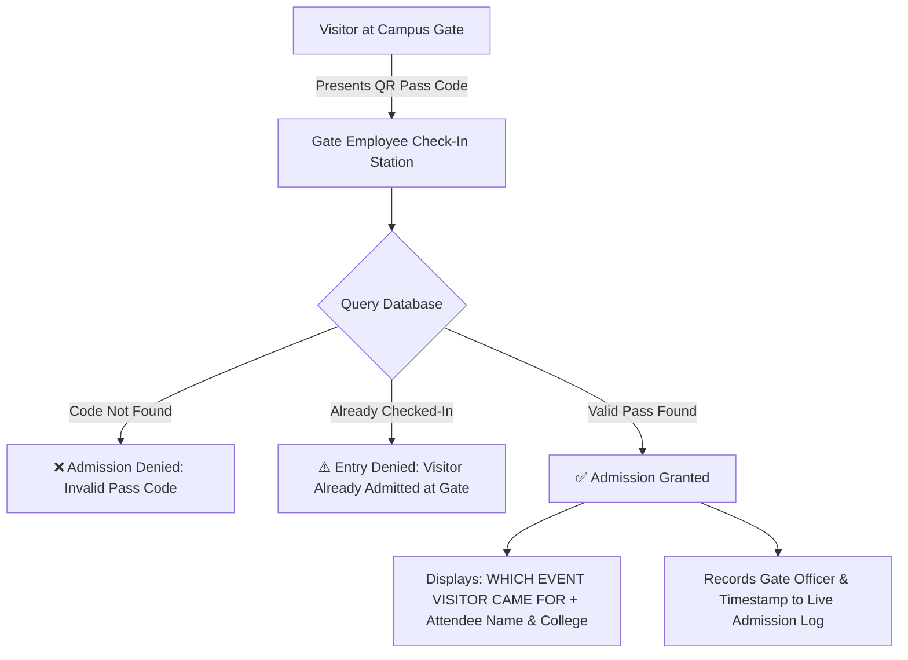

# EventPass — Event Registration, Dynamic Pricing & Gate Check-In Platform

[](https://www.python.org/)
[](https://flask.palletsprojects.com/)
[](#)
[](#)
[](LICENSE)

An enterprise-grade campus event orchestration platform engineered with **Python 3.11, Flask 3.0, SQLAlchemy, dynamic NPCI UPI QR code generation, and ReportLab PDF boarding pass issuance**.

Developed as part of the **Industrial Training & Final Technical Project (Subject Code: NBCA 308P)** at **City College of Management, Lucknow**, under the guidance of **Global Horizon Infotech** by **Sanjogita** (Roll No: 2511755060086) under the supervision of **Mr. Danish Khan**.

---

## 🌟 Core System Highlights (7-Point Specification)

1. **Role-Gated Check-In Station**:
   - The public check-in scanner has been **removed from normal user navigation**.
   - Check-in scanning is strictly restricted to **Entrance Gate Employees** and **System Administrators**.

2. **Admin-Controlled Pricing & Promotional Offers**:
   - The previous "100% Free" blanket banner has been replaced with granular financial controls in the **Admin Control Panel**.
   - Administrators can publish events with custom base prices (e.g. ₹499, ₹299), active discounts, and promo codes (e.g., `TECH200`, `CAMPUS50`).

3. **Event Detail Page & Linear Registration with End Payment**:
   - Clicking an event card opens a dedicated **Event Details Page** featuring high-res imagery, detailed itineraries, speaker keynotes, venue maps, and pricing tiers.
   - The **"Get Your Pass"** flow guides the user through filling attendee details, applying coupon discounts, and selecting a payment method (Dynamic NPCI UPI QR or NetBanking/Card simulation) **at the end of the form**.

4. **Dynamic Registration Form Schema (Issued by Admin at Event Publishing)**:
   - When an administrator publishes an event, they select and configure the required attendee fields (e.g., Mobile / WhatsApp, College / University, Student Roll No, Academic Department & Semester, T-Shirt Size, Dietary Preferences).
   - The registration modal dynamically renders the exact fields issued for that specific event.

5. **Real-Time Seat Capacity Tracking**:
   - Live seat capacity counters and visual progress bars (`118 / 150 Filled • 32 Seats Remaining`) are displayed across the event catalog, detail view, and registration modal.
   - Remaining capacity decrements in real time upon booking, transitioning to a locked `SOLD OUT` state when 100% full.

6. **Downloadable / Printable Boarding Ticket Passes**:
   - The **"My Passes"** section provides a **"Download / Print Ticket Pass"** button.
   - Renders a professional boarding pass with perforated tear-off entrance stubs, high-contrast QR codes, pass code barcodes, attendee details, and `window.print()` / PDF trigger.

7. **Main Entrance Gate Employee Check-In Panel**:
   - Dedicated gate employee station (`viewGateStaff` / `/gate/check-in`).
   - Entering or scanning a pass code immediately highlights **WHICH EVENT THE VISITOR CAME FOR** in bold typography.
   - Validates single-entry admission, records gate officer timestamps, and actively prevents ticket duplication/reuse with instant alerts.

---

## 🔑 Demo Access Credentials & Default Passwords

> [!IMPORTANT]
> **Staff Gate Check-in & Admin Access**: The check-in QR scanner is protected from public attendees and accessible via the **"Main Gate Check-in"** station. Super Admin uses `admin` / `admin123`.

| Role | Interface Location | Username / Pass Code | Password | Capabilities |
| :--- | :--- | :--- | :--- | :--- |
| **Public Attendee** | Main Catalog | *Any Attendee / Student* | None | Browse events, view details, get passes, apply promo codes, print boarding ticket passes |
| **Gate Employee** | **"Main Gate Check-in"** button | *Pre-authenticated Gate Station* | None | Scan incoming visitors, verify target event, admit attendees, block duplicate passes |
| **Super Admin** | **"Admin"** button | **`admin`** | **`admin123`** | Publish new events, control base prices/discounts, issue custom attendee forms |
| **Demo Boarding Pass**| Gate Scanner | **`EVT-PASS-91A2C4`** | — | Verified sample pass for attendee *Sanjogita* (*Annual TechFest 2026*) |

### 🏷️ Active Promo / Discount Coupons
- **`TECH200`** — Flat ₹200 Discount on TechFest passes
- **`CAMPUS50`** — 50% Half-Price Student Discount

---

## 🖥️ Standalone Browser Demo & Quick Execution

A zero-dependency browser simulation is pre-packaged inside the repository root:
- **Instant Browser Launcher**: Open `demo/index.html` directly in any web browser.
- **Direct File Path**: [demo/index.html](file:///C:/Users/KRIN/.gemini/antigravity/scratch/03-eventpass-flask/demo/index.html)

---

## 🏗️ Gate Admission & Check-in Architecture



---

## 📦 Python Flask Execution

```bash
cd C:/Users/KRIN/.gemini/antigravity/scratch/03-eventpass-flask

# 1. Install dependencies
pip install -r requirements.txt

# 2. Seed default events, users, and credentials
python seed_data.py

# 3. Launch Flask web server
python run.py
```
Visit `http://127.0.0.1:5000` in your web browser.

---

## 💡 Key Technical Viva / Interview Q&A

1. **How is the entrance check-in station protected from unauthorized public access?**
   * *Answer*: By removing check-in elements from the public user catalog and placing the check-in panel under an authorized employee route (`/gate/check-in`) requiring staff or admin session authentication.
2. **How does the system prevent ticket duplicate entry at the gate?**
   * *Answer*: Each pass record contains an `is_checked_in` boolean flag. When a gate employee scans a pass code, the backend verifies `is_checked_in == False`, marks it `True`, records the timestamp, and atomically commits the transaction. Subsequent scans trigger an immediate duplicate entry warning.
3. **How are custom attendee registration schemas stored?**
   * *Answer*: The `Event` model stores custom form requirements as a JSON structure (`required_fields: ["mobile", "college", "roll_no", "diet"]`). The frontend dynamically iterates over this schema to render the required input fields during checkout.
4. **How is real-time seat capacity managed under concurrent registrations?**
   * *Answer*: Using SQLAlchemy database transactions with row-level locks on the `Event` entity (`with_for_update()`). Capacity is verified before payment settlement, ensuring that once `filled_seats >= max_capacity`, no further tickets can be sold.
5. **How does the ReportLab PDF engine generate printable boarding passes?**
   * *Answer*: ReportLab generates a vector PDF containing high-contrast QR codes, barcode lines, event details, attendee credentials, and a tear-off admission stub for physical gate scanning.

---

## 📄 License & Attribution
Designed and engineered by **Sanjogita** (BCA 3rd Sem, Roll No. 2511755060086) under the supervision of **Mr. Danish Khan**, Assistant Professor, City College of Management, Lucknow.
Licensed under the [MIT License](LICENSE).
